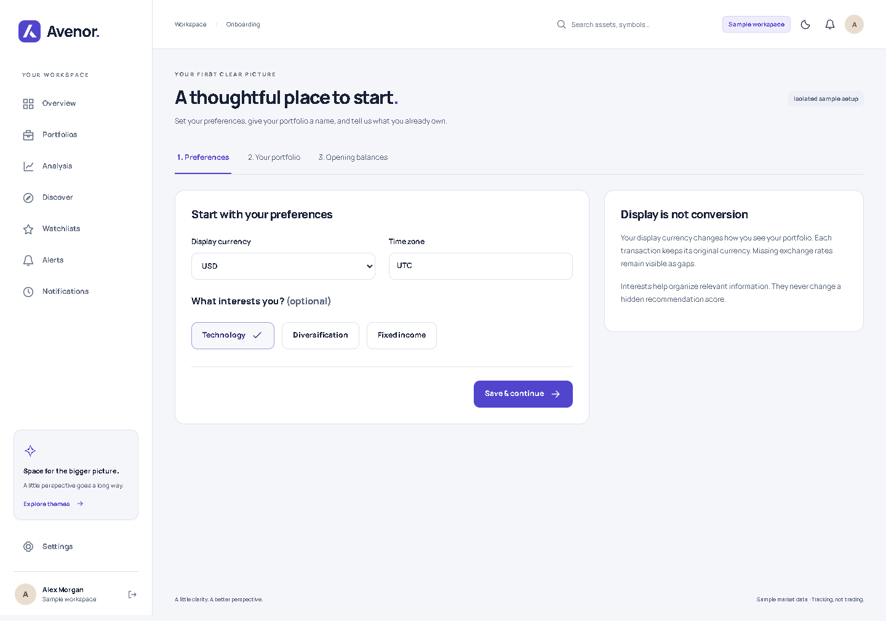
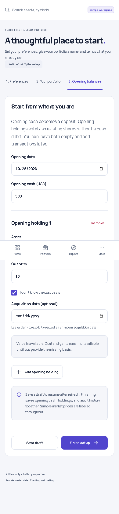
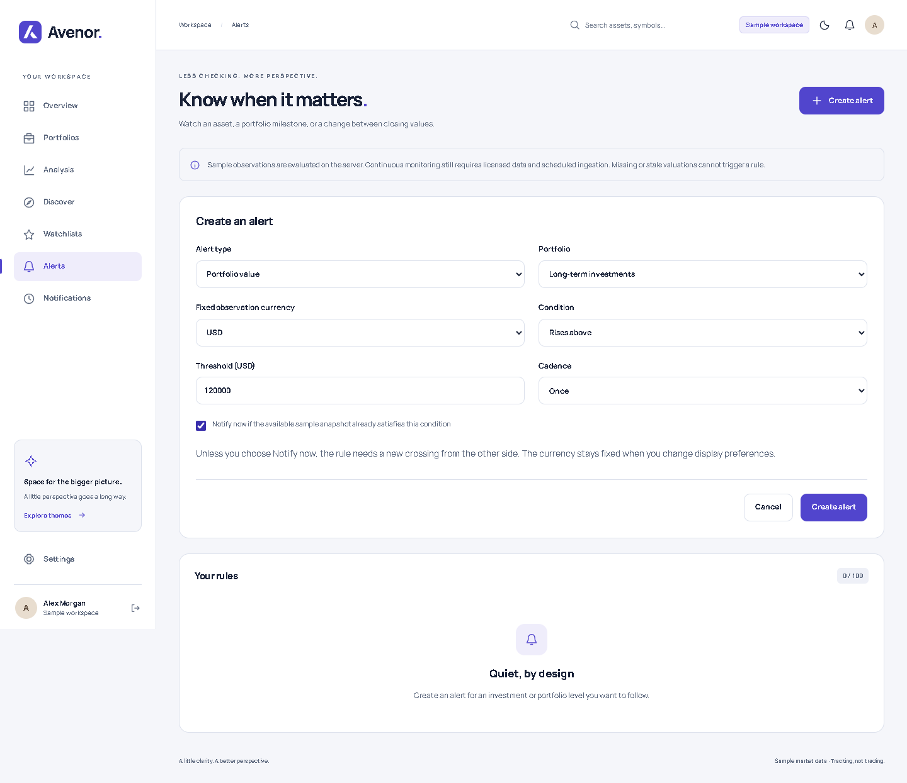
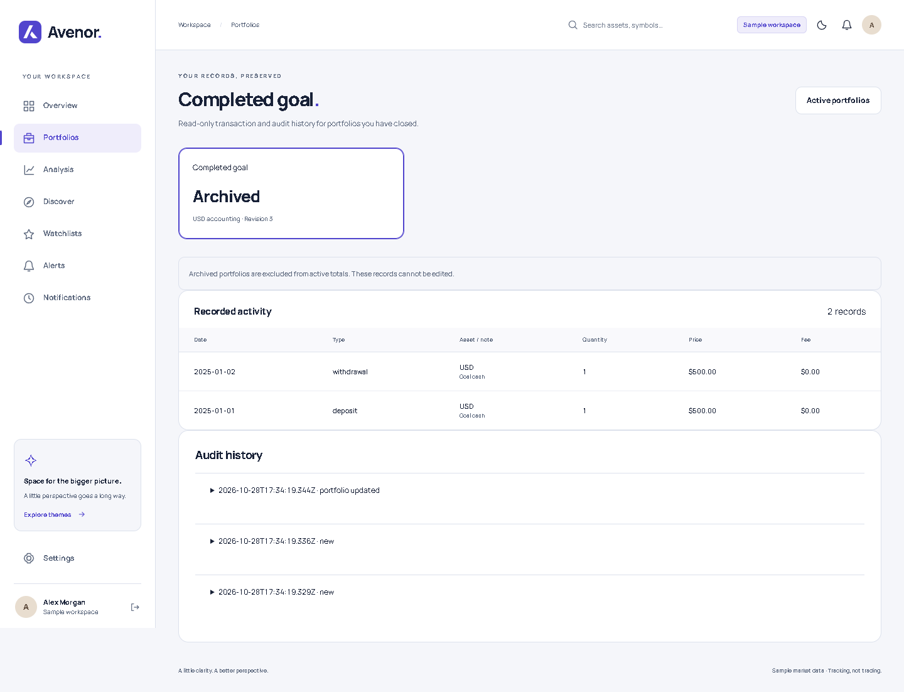
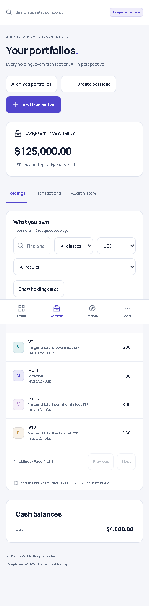

# Changelog

## Unreleased

### Added

- Browse archived portfolios, transactions, and audit history in a read-only view without changing active portfolio totals.
- Filter holdings by quote currency and switch between mobile cards and a horizontally scrollable full table; both choices survive refresh through the page URL.

- Resumable setup for preferences, interests, a first portfolio, and opening balances. Save a draft to continue after refresh; finishing records cash and holdings atomically.
- Opening holdings with optional acquisition dates and unknown cost basis. Shares still have a value, while unavailable cost and gains remain explicitly unavailable until corrected.
- Fixed-currency portfolio-value and cash-flow-adjusted daily-loss alerts, plus optional Notify now for already-satisfied price/value snapshots. Sample observations support deduplication, stale-data rejection, and reset/cooldown rules; continuous monitoring still requires provider ingestion.

- Angular investment workspace with responsive navigation, light/dark/system themes, sample overview, portfolios, analysis, discovery, asset detail, watchlists, alerts, notifications, and settings.
- Persistent, isolated demo accounts and a server-authoritative decimal ledger with FIFO accounting, backdated validation, paired FX legs, split events, immutable correction history, and duplicate-save protection.
- Holdings filters and allocation with explicit missing-data coverage; synthetic charts and sample quotes are labeled throughout.
- Server-side sample price-crossing evaluation, recurring reset/cooldown rules, and in-app notification read state.
- Calculation/API/browser regression tests, CI checks, setup documentation, and a specification coverage/release checklist.
- Root `AGENTS.md` containing the user's Git, changelog, branch, commit, code-review, and handoff workflow for future Codex work.

### Fixed

- Holdings cards and tables now share 25-row pagination and return to the first page after filtering. Sorting uses decimal values and keeps unavailable values last in either direction.

- Prevent archiving the first portfolio during opening-balance setup, which could otherwise leave setup unable to finish.
- Reject malformed acquisition dates in transaction requests before they can break holding details or editing.

### Security

- Object ownership, CSRF protection, same-site HttpOnly sessions, secure production cookies, password hashing, rate limits, CSP, single-use expiring recovery tokens, and revision-protected server state.
- Real registration remains disabled until an email adapter is configured. No production market feed or financial-history export is implied by the sample workspace.

### Compatibility and migration

The development API now accepts `opening` transactions. Cost basis, average cost, and realized gain may be `null` when an opening lot has unknown basis; clients must render unavailable values instead of treating them as zero. Existing saved workspaces remain readable without a database migration. No release or deployment is implied; package version remains 1.0.0.

### Interface previews

Choose display preferences and optional interests before creating the first portfolio.

Save an opening-balance draft and leave cost basis or acquisition date unknown.

The rule keeps its observation currency even when display preferences change.

Archived portfolios preserve their records in a separate read-only history view.

Mobile users can switch to a scrollable table and compare every column.
