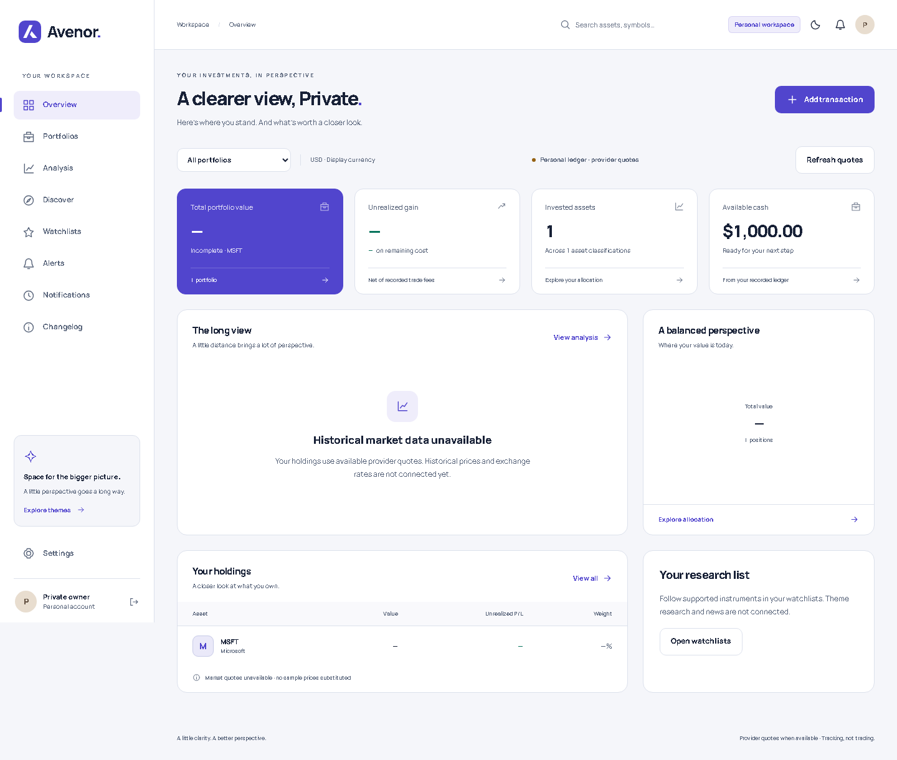
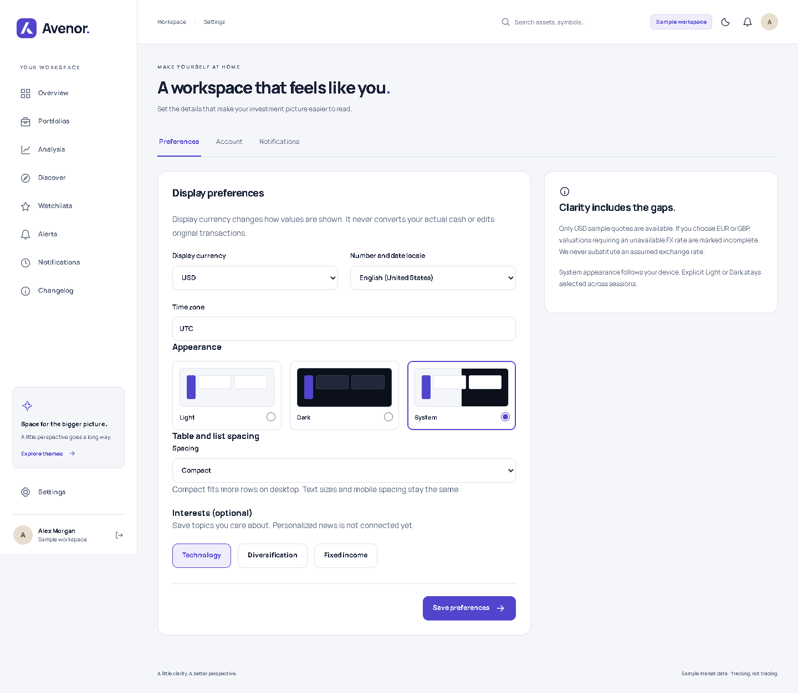
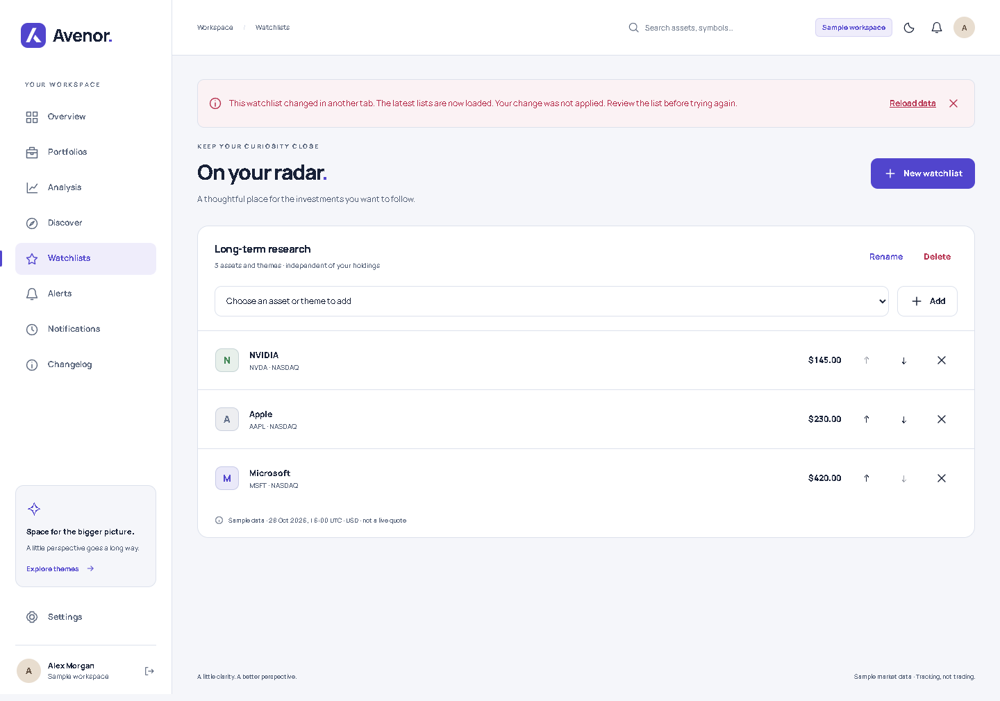
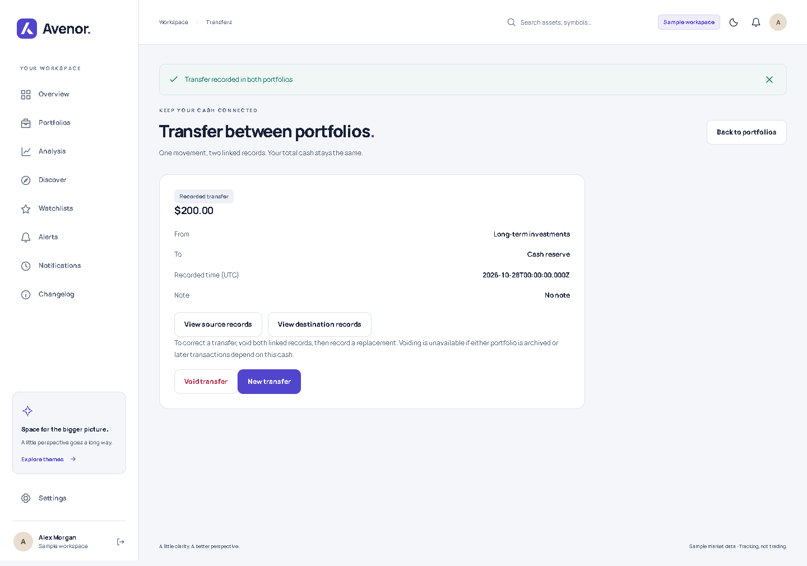
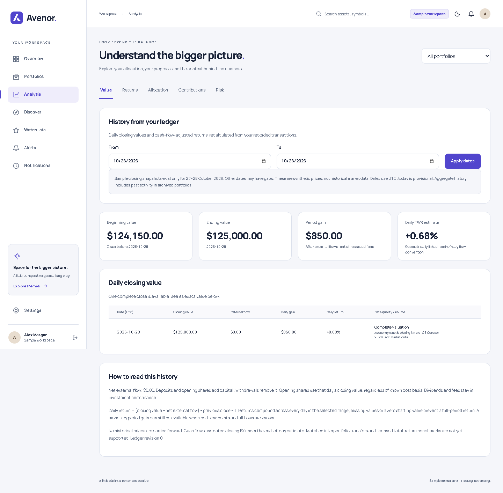

# Changelog

## Version 1.1.0 — Unreleased

Current app version: 1.0.0

A clearer investment workspace — holdings, history, and connected cash.

Set up your holdings, revisit portfolio history, and understand changes in value with visible data-quality limits.

### Highlights

- Transfer cash between your portfolios with two linked records and no change to aggregate external contributions.
- Explore ledger-based history, archived records, and the full holdings table on mobile.
- Follow price, portfolio-value, and daily-loss thresholds with in-app sample alerts.

### Release status

These changes are in development, not a published production release. The package version is 1.0.0; no numbered release or release date has been assigned. A future compatible feature release would target 1.1.0, subject to the API compatibility review below.

### Compatibility and migration

Existing saved workspaces remain readable without a database migration or configuration change.

Development API clients must accept opening transactions. Cost basis, average cost, and realized gain can now be null when an opening holding has unknown cost. Display these values as unavailable, not zero. If this API becomes a supported public contract before release, assess these changes for a major version increment.

The new authenticated /v1/history endpoint accepts a portfolio, currency, and date range of up to 366 days. It checks portfolio ownership and returns explicit gaps for unavailable historical prices or exchange rates.

Watchlist update and delete requests now require the list's revision. Older saved lists start at revision 0. Development API clients must send the revision returned with each list (0 when absent on a legacy list) and reload after a conflict; requests without a matching revision are rejected.

Existing preferences without a density setting use Comfortable spacing. Density and interests can be omitted from development API requests without clearing their saved values. When provided, density must be Comfortable or Compact and interests must use the available Technology, Diversification, or Fixed income options.

### Added

#### Prepare a private workspace with real accounts and quotes

Private deployment now supports owner-only registration, verification and password recovery, with queued email retries. The server can load Twelve Data quotes for the supported catalog; missing, stale or failed quotes remain unavailable. Real accounts no longer receive synthetic quotes, themes, overview charts or risk illustrations.

Render deployment settings and a private-launch guide describe persistent storage, server-only credentials and backups. This integration is prepared for personal use; live deployment, email delivery and provider entitlements still need to be configured and verified. Historical prices, FX, news and continuous alert monitoring are not connected.

Actual local real-account view with no provider key: missing quotes stay unavailable instead of showing demo prices.

#### Adjust your workspace as your interests change

Settings now lets you edit optional interests after setup and choose Comfortable or Compact spacing for desktop tables and watchlist rows. Saved choices return when you reopen the workspace. Mobile spacing remains comfortable for touch controls.

Preferences saved in another tab cannot be overwritten by an older form. If a conflict occurs, review your unsaved choices and explicitly reload the latest preferences before editing again. Interests are saved for future personalization; a live personalized news feed is not connected.

Choose your display spacing and interests together in Preferences.

#### Keep watchlist changes safe across tabs

Watchlists now detect when another tab has changed the same list. An outdated rename, item change, reorder, or deletion is rejected so it cannot erase newer work. The app loads the latest lists after a conflict; review those changes before trying your edit again. Independent alerts remain untouched.

An older tab explains the conflict before any newer changes can be overwritten.

#### Move cash between portfolios

Transfer a cash amount between two active portfolios in the same currency. Both records are saved together, with duplicate-save protection and balance/revision checks. Each portfolio sees its own contribution or withdrawal; aggregate history excludes the matched pair from external flows.

Review either side from the transfer receipt. To correct it, void both records together and enter a replacement. Voiding is blocked if later activity relies on the destination cash. Cross-currency transfers and transfer fees are not included; record currency conversion or fees separately.

A single receipt connects both portfolios. Corrections void the pair together, preserving the audit trail.

#### Start with what you already own

Choose display preferences and interests, create your first portfolio, and enter opening cash and shares. Save draft preserves unfinished balances across refreshes. Finishing records opening balances together, without treating existing shares as a new purchase.

Leave acquisition dates or cost basis unknown when needed. Shares can still have a value; unavailable cost and gains stay unavailable until you correct the opening record.

Opening setup on mobile: record what you know and save the rest for later.

#### See history that follows your ledger

Analysis now calculates daily closing values, external flows, period gain, and daily time-weighted return estimates from recorded transactions. Select dates, inspect exact values and sources, and see backdated corrections when history reloads.

Sample accounts have only two synthetic closing snapshots, for 27–28 October 2026. Longer ranges show gaps. Missing observations are never replaced with today's prices, and incomplete periods cannot claim a complete return.

The sample day reconciles to $125,000 ending value and $850 gain; every observation identifies its synthetic source.

#### Keep closed portfolios within reach

Archived portfolios have a read-only transaction and audit history. Browsing them does not change active totals. Holdings also support currency filters and a mobile full-table view; filter and view choices survive refresh.

A closed portfolio keeps its records accessible while remaining outside active totals.

#### Follow the changes that matter

Create price, fixed-currency portfolio-value, or cash-flow-adjusted daily-loss alerts. Notify now can deliver an in-app notification when an available price or value snapshot already meets the condition. Otherwise, rules wait for a fresh crossing, with duplicate prevention and recurring-rule reset and cooldown controls.

The observation currency stays fixed even if your display currency changes. Continuous monitoring still needs scheduled provider ingestion.

#### Find these notes inside Avenor

The Changelog page is available from desktop navigation and the mobile More menu. It reads the same notes as this file and offers full-size screenshots without creating a separate copy of the release text.

### Changed

- Analysis value and return views now use ledger-based history. The overview chart remains a separately labeled illustrative sample.
- Mobile cards and the full holdings table share 25-row pagination; filtering returns to the first page.
- Holdings sorting preserves decimal precision and places unavailable values last in either direction.

### Fixed

- Prevented archiving the first portfolio before opening-balance setup finishes, which could leave setup stuck.
- Rejected malformed acquisition dates before they could break holding details or transaction editing.
- Corrected opening capital valuation when a same-day stock split changes the share count, preventing a false gain.
- Prevented older history responses from replacing the currently selected portfolio's results.
- Kept uncertain transfer retries bound to their original receipt during browser navigation.

### Security

Workspaces are isolated by account. Server checks enforce ownership, revisions, duplicate-save protection, and session/CSRF controls. Transactions retain correction and void audit history. Production registration requires an approved email allowlist and a configured email provider; demo access is disabled in production.

### Known limitations

- Demo quotes, themes and closing snapshots remain synthetic. Real accounts use configured provider quotes or unavailable values. Licensed historical prices, FX, news, fundamentals and benchmarks are not connected.
- Alerts can evaluate supplied sample observations, but continuous monitoring needs a server ingestion scheduler. Email and push delivery are unavailable.
- Daily returns use an end-of-day flow estimate. Large net flows show a timing warning; detailed intraday flow treatment remains unfinished. Matched same-currency transfers are excluded from aggregate external flows.
- Production identity, account management, retention, backups, and deployment security/accessibility reviews remain launch requirements. This development app is not a production-ready financial service.

### Verification

The current application passed 51 calculation/API tests, 21 browser journeys, and the production build. The history increment also passed GitHub checks. Independent review findings were fixed and re-reviewed. Screenshots above were captured from the running app with sample data. Automated accessibility checks do not replace manual screen-reader and device reviews.
