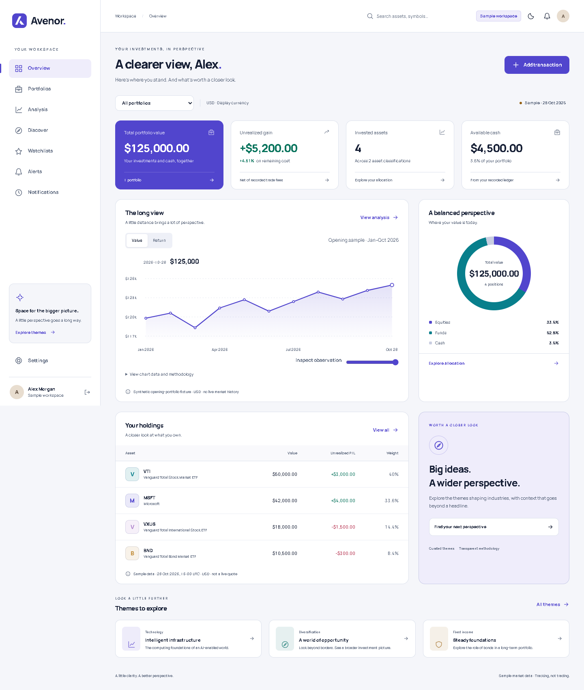

# Avenor

A personal investment tracker built with Angular, TypeScript, Tailwind CSS, Express, and SQLite. The application implements the manual-accounting and exploration foundation of the Avenor specification, with an isolated sample workspace and explicit data-quality boundaries.



## Run locally

Requires Node.js 24.13 or later and npm. Dependencies are pinned; commit the lockfile with dependency changes.

```sh
npm ci
npm run dev
```

Open **http://127.0.0.1:4200** and choose **Explore the sample workspace**. Each new demo session has its own server-side workspace. The sample persists across refreshes through an HttpOnly cookie and SQLite. It is never merged into another account.

Choose **Start an empty sample workspace** to try the three-step setup. Use **Save draft** to persist unfinished opening balances. Unknown cost basis leaves gains unavailable until you edit the opening transaction.

For the production build:

```sh
npm run build
npm start
```

The Express server serves the built application at **http://127.0.0.1:3001**. Run behind a configured HTTPS reverse proxy for production and set `NODE_ENV=production` for Secure cookies. The default listener binds to loopback. See `.env.example`; configure process environment variables explicitly (the app does not implicitly load `.env` files).

## Implemented

- Responsive shell, lazy Angular routes, Manrope typography, semantic Tailwind tokens, light/dark/system appearance before first paint, mobile navigation, keyboard-accessible native confirmations, chart data tables, and reduced-motion support.
- Server-owned demo sessions, portfolio creation/rename/archive, private workspace isolation, persisted preferences, and account/login/recovery/verification endpoints behind an explicit email-adapter configuration.
- Decimal-string transaction APIs and decimal arithmetic: deposits, withdrawals, buys, sells, dividends, fees, paired FX cash legs, and splits. FIFO lots, fee-inclusive cost basis, realized/unrealized gains, backdated ledger validation, correction/void audit history, idempotency, and revision conflicts.
- Authoritative server valuations and aggregated positions across portfolios. Missing prices/FX remain unavailable; they never become zero. Original-currency accounting remains intact when display currency changes.
- Search/filter/sort holdings, transaction history, holding lots, allocation categories, concentration, explanatory risk views, and an explicitly separate synthetic opening-portfolio chart with a tabular alternative.
- Curated themes with thesis/counterpoint and unrated evidence eligibility, asset detail, watchlist creation/rename/membership/reorder/removal, theme following, price crossing alerts, server evaluation of sample observations, and in-app read/unread notifications.
- API authorization, CSRF tokens, same-site HttpOnly sessions, secure production cookies, CSP, rate limiting, hashed passwords and single-use recovery tokens, SQLite atomic writes, and workspace revision protection against stale responses.

## Data and release boundaries

**This is a functional development implementation, not a production-ready financial service.** All displayed quotes are the specification's synthetic snapshot dated 28 October 2026. The historical chart is a separate disclosed fixture, not live or reconstructed market history, and does not change when the manual ledger changes.

Live/delayed quotes, historical FX, total-return benchmarks, OHLC, licensed news/events, fundamentals, and point-in-time theme evidence require external provider selection, rights, credentials, and ingestion work. Unsupported panels explain the missing data instead of fabricating it. EUR/GBP cash transactions are supported, but converted valuations are unavailable without FX coverage.

Real registration is **disabled by default**. Optional local account flows require `ENABLE_LOCAL_ACCOUNTS=true`, `APP_ORIGIN`, and a server-only `EMAIL_WEBHOOK_URL`. The adapter receives `{ email, kind, url }` with an optional Bearer secret. Production use additionally requires reliable email delivery/retries, identity-provider compromised-password screening, account/session management, a retention/deletion policy, backups, telemetry, and deployment security review.

The sample observation endpoint evaluates alerts on the server. Continuous evaluation while the browser is closed requires a provider-ingestion scheduler. Portfolio-value and daily-loss alerts use a fixed observation currency. Daily loss compares consecutive UTC sample closing dates after removing net external flow; it is not peak-relative drawdown. Missing/stale/gapped closes reset the comparison. Full historical performance/benchmark switching, historical FX basis, account email/password/session management, and mobile full-table mode remain follow-on work. See [implementation status](docs/IMPLEMENTATION.md) for the specification coverage and release gates.

## Verification

```sh
npm run check                 # server/domain typecheck, domain/API tests, Angular production build
npm audit --audit-level=high
npx playwright install chromium
npx playwright test           # production-served browser journeys and axe checks
```

To use an installed browser, set `BROWSER_CHANNEL=chrome` (or `msedge`). Tests write screenshots under `docs/screenshots` and diagnostic artifacts to ignored `test-results`. Browser tests cover theme persistence, navigation, creating a portfolio and deposit/purchase, transaction revision/audit, watchlists, alert crossing, notifications, and layouts down to 320 px. Automated accessibility checks do not replace manual screen-reader verification.

## Project layout

```text
src/app/core/       Session and server-state signals, request boundary, theme
src/app/domain/     Framework-independent entities, decimal ledger and calculations
src/app/features/   Lazy standalone feature pages and typed forms
src/app/shared/     Icons, empty states, source metadata, accessible fixture chart
server/            HTTP API, SQLite persistence, isolated fixtures, alert evaluator
tests/             Calculation, integrity, authorization and browser regression tests
```

The database and all credentials are ignored by Git. Do not commit `data/`, `.env`, session tokens, or user financial records. Follow [AGENTS.md](AGENTS.md) for branching, changelog, review, commits, and publication.
